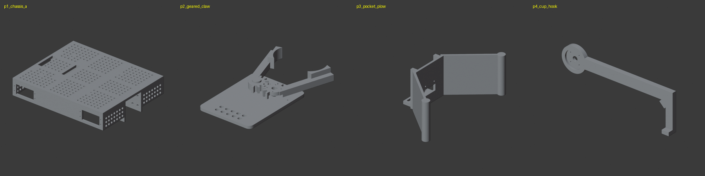

# 3D-printed parts: the 4 we print

**Team rule (Nov 3, 2026): 4 printed parts in total, any size** up to the printer bed (Ender 3 V3 SE: 220 × 220 × 250 mm). **A moving assembly printed in one go counts as 1 part.** This replaces the 6 small / 2 mid / 1 large classes in the rule summary, so the old 9-part list is gone. PLA or PETG, grey only, and the STL of every part is submitted before the tournament.

All four are generated by Blender scripts and checked automatically:

```bash
python tools/blender/build_parts.py
```

That writes `parts/team4/<part>.stl` (millimetres, slicer-ready), previews, and [parts/team4/budget.md](parts/team4/budget.md). The build fails if a part doesn't fit the bed, isn't watertight, has the wrong number of bodies, or if the plan goes over 4 parts. **Every size in the scripts comes from the CAD model, not real pieces:** measure ducks, pom, cup rim, servos and horns, edit the `MEASURE` constants at the top of each script, and re-run before printing.



| # | Part | Robot | Size (mm) | What it does | Points it protects (×5) |
|---|---|---|---|---|---|
| 1 | **Robot A chassis with built-in duck lane** `p1_chassis_a` | A | 214 × 180 × 47 | Replaces the metal chassis, standoffs, motor brackets and the rear of the metal lane. Deck sits 46 mm up so a 1.6" duck passes under it; the 1.8"-wide channel walls stop **4 mm above the floor**; exit gate A and pin gate B slots with servo holes; lane-full switch window; 4 motor windows with ear screw holes at 30 mm axle height (60 mm mecanum wheels); Wombat hole pattern; **448 accessory holes** (4.4 mm on an 8 mm grid) on the deck and on the front and rear bumpers. Robot width with wheels ≈ 272 mm, inside the 11.25" (286 mm) start box. | The multiplier: a double drop costs a whole zone |
| 2 | **Geared claw** `p2_geared_claw` | B | 90 × 143 × 18 | **Print-in-place**: two fingers printed already assembled with meshing gear sectors. The left one turns on a captive printed pin; the right one is driven directly by the micro servo under the base (horn screwed into a pocket in its hub), so one servo opens both. Concave pads hold the 1.6" red pom. The script checks ≥ 0.35 mm clearance over the whole ±25° swing (0.40 mm measured). | Red pom alone on the platform: 255 |
| 3 | **Pocket plow** `p3_pocket_plow` | B | 108 × 206 × 72 | One piece instead of two bent plates: flat centre face plus forward wings, so a pushed pom stack stays in the pocket as one group. Rounded tips, a lever-switch pocket, and slotted mounting tabs. | 5 pom groups in zone 1: 200; pickleball: 40 |
| 4 | **Cup hook** `p4_cup_hook` | B | 157 × 13 × 62 | Stiff arm on the hook servo's horn. Its tip drops 1.5" and ends in an inward lip that catches the cup rim while the plow wing rolls the cup upright. | Both cups upright: 210 |

**Not printed:**
- **The front 4" of the duck lane, the intake funnel and intake gate C:** kit metal (two 4×12 plates and two flared 1×10 straps), bolted to the lane wall ends at the front of print 1 (holes provided). The full lane is 12.5" (317 mm), longer than the 214 mm chassis and the bed. The 5 ducks need it all.
- **The ring fork:** dropped, because nothing on the robots can lift it 9".
- **Claw pads, plow end caps and the flap pad:** they were separate prints and are now built into prints 2 and 3.

### Order and settings

1. **Print 1 first** (≈ 300 cm³ of PLA, a long print: ~15–20 h at 0.2 mm). It carries the whole duck robot and the escapement, the only mechanism that touches the multiplier. Bench target: 50 drops in a row with no double drop. **Measure the motor and its ears first**: the motor windows and ear holes are estimates from the Blender model.
2. Then print 2 and print 4. Print 3 last, and only after checking that the cup flips (Robot B's first 16 s) still work with the pocket shape: the metal V had its point forward.
3. Grey PLA, 0.2 mm layers, 3 walls, 20% infill, no supports.
   - Print 1 deck-down (upside down), no supports: the walls grow upward and the motor windows bridge 21 mm. 214 mm on a 220 mm bed leaves 3 mm per side: no brim.
   - Print 2 flat, base on the bed. Rock the fingers right after printing to free them.
   - Print 3 standing up.
   - Print 4 on its side.
4. Export and submit the 4 STLs from `parts/team4/` on the Team Home Base schedule.

### History

The first version of this file ranked 9 parts for the old class rule: a duck lane in 2 halves, claw pads ×2, cup hook, plow end caps ×2, flap pad and the ring fork. The 9-part alternative from `docs/strategy-alt.md` can still be generated with `python tools/blender/build_parts.py --alt`, but it is over the 4-part limit.
