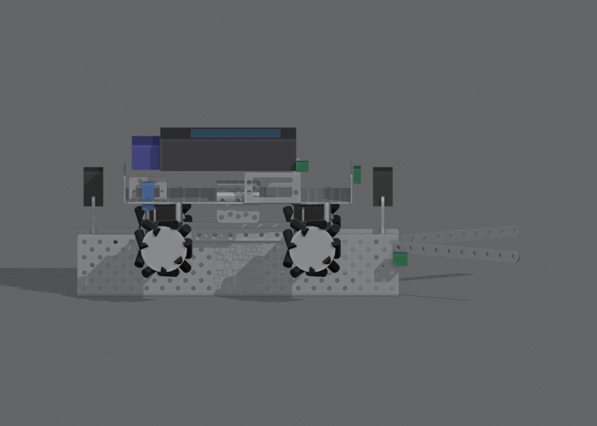
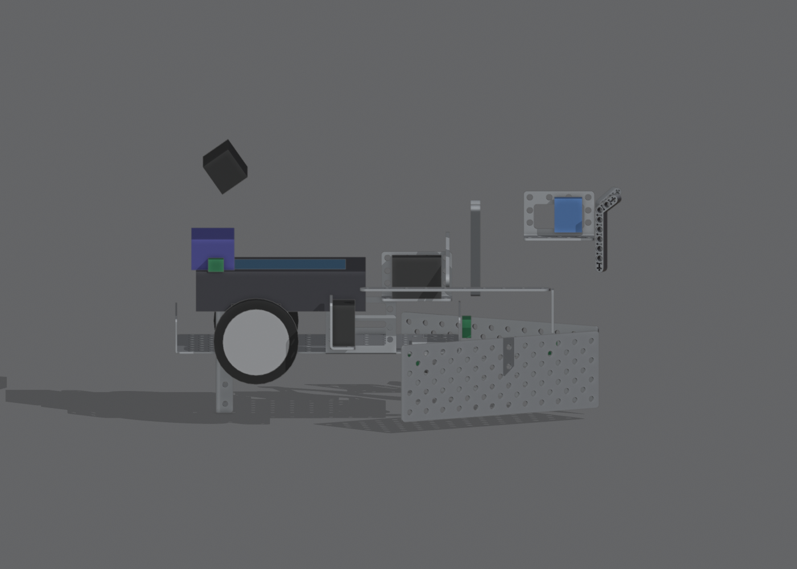

# How we do everything: build, wire, code, test, compete

This is the step-by-step manual. The plan is in [STRATEGY.md](../STRATEGY.md); what each part does is in [ROBOTS.md](ROBOTS.md); the **picture manual** with every part named and every screw hole shown (also as a video) is [manual/build_manual.html](manual/build_manual.html). Event: **Dec 5, 2026** (virtual).

Coordinates for part positions below: **robot frame, inches**. Origin = centre of the chassis plate, **+x = forward** (the direction the robot drives at the start: east), **+y = left**, **z = height above the floor**. They come straight from the Blender model (`blender/build_fall_game.py`), so measure and adjust on the real parts.

---

## 0. Order of work (≈ 4½ weeks left)

| Week | Do | Done when |
|---|---|---|
| Nov 3 | §1 inventory + buy pieces; §2 practice table; start §3 Robot A frame and §4 Robot B base | Table matches the official overhead photo; both robots drive straight |
| Nov 10 | Finish both builds, §5 wiring, §6 upload code, §7 calibrate; print the duck lane (§8) | Both robots start on the light and stop by 118 s, 10/10 |
| Nov 17 | §9 mechanism tests: duck escapement 50/50, cup flip, red-pom grab | Each mechanism passes its bench target |
| Nov 24 | Full matches with both robots, log every run (§9.3), fix the top failure each day | Core run (730) ≥ 6/10 |
| Dec 1 | Freeze code, submit STLs, rehearse setup in 90 s (§10) | 3 clean dress rehearsals |

Jobs can run in parallel: one pair builds A, one pair builds B, one person does the table and pieces.

---

## 1. Before building

1. **Count the kit** against [docs/2026 Electronics Kit.pdf](2026%20Electronics%20Kit.pdf): we need **6 gear motors** (4 A + 2 B), **5 servos + 1 micro servo**, **2 Wombats + 2 batteries**, 4 mecanum wheels, 2 Solarbotics wheels, 1 caster, **2 light sensors**, **4 tophats**, 2 ET rangefinders, 1 lever + 1 small touch switch, 1 camera, 2 chassis. Our inventory sheet lists no motors and no light sensors: find them first.
2. **Chassis check**: the rules ban "the old KIPR aluminum chassis". Put a magnet on ours (steel sticks) and ask the Head Judge if unsure.
3. **Buy the 2026 game pieces** (our "Parcour" bag is last year's game): 5 small rubber ducks (~2.25"), 1 big duck, 4 pickleballs, 2 cups (green + teal), 6 rings, 3 blue bottles, 25 pom-poms 1.5" (5 each: red, green, lavender, turquoise, gold), Botguy.
4. **Measure the real pieces** (duck, cup rim, pom, ring) and write the numbers in `docs/team-hardware-confirmed.md`. Lane width, hook height and claw opening depend on them.

## 2. Practice table

Build it from [Fall_Game_Table.pdf](../Fall_Game_Table.pdf) (bill of materials on sheet 2): 4'×8' particle board, white FRP (bumpy side up), 1" PVC border with the listed cut lengths, 18×24" corrugated plastic for the raised platform, black 3M duct tape. Place the tape with the sheet 7 dimensions (24.50" and 11.25" from the bottom PVC, 21.125" box). Set every piece exactly as in [docs/official/Fall_Game_Table_Overhead.png](official/Fall_Game_Table_Overhead.png): pom stacks 3 + 1 at 8" spacing on the upper tape (left half), ducks at 8" spacing (right half), cups upside-down on the two tape crossings (red pom + 2 others under the lower cup, 2 under the upper), Big Duck on the platform, Botguy behind the top wall at the centre. Virtual tournaments also need **two cameras** (fixed overview + one movable) and an adult who attests the table.

---

## 3. Build Robot A: "Duck Runner" (printed chassis, ≈ 272 mm wide with wheels)

The idea: a mecanum robot whose chassis is **print 1** ([3D_PRINTS.md](../3D_PRINTS.md)): a deck 46 mm above the floor with a **1.8"-wide duck channel built into its underside**, running front to back. The channel walls stop 4 mm above the floor. Ducks enter at the front, slide back, and one at a time is left on the floor. (The render above is the earlier kit-metal version of the same layout.)

Coordinates are the chassis frame in mm: origin at the centre of the chassis footprint, +x forward, +y left, z up from the floor.

| Step | Part (qty) | Where it goes | Check |
|---|---|---|---|
| A1 | **Print 1** `p1_chassis_a` (214 × 180 mm) | Clean the holes with a 4.4 mm drill if tight; check the 4 motor windows fit a motor body | Deck flat, lane walls straight |
| A2 | Gear motor (4) | Push each body into its side-wall window from outside, shaft facing out; screw the ears to the wall (4 holes per motor). Axles at x = ±88, 30 mm above the floor | All 4 shafts level; nothing rubs |
| A3 | Mecanum wheel (4) | On the motor shafts. **Rollers make an X seen from above** | Robot strafes, not just spins; total width ≤ 11.25" |
| A4 | Plate 4×12 (2) + Strap 1×10 (2), flared 35° | **Intake extension**: bolt the plates to the outside of the lane walls at the chassis front (holes at x = +87 and +99), the straps on their front ends as the funnel. Inside width stays 1.8" | A duck slides from the funnel into the printed lane without catching |
| A5 | Servo + 1×5 horn: **intake gate C** | On top of the left extension plate, ~2" in front of the chassis; horn hangs across the lane | Opens 90° clear |
| A6 | Micro servo + 1×5 horn: **pin gate B** | On the deck beside the slot at x = −41 (right side), horn down through the slot | Closed: holds the 2nd duck from the rear |
| A7 | Servo + 1×5 horn: **exit gate A** | On the deck beside the slot at x = −97 (left side), horn down through the slot | Closed: ducks stop against it |
| A8 | Small touch switch: **lane full** | In the window in the right lane wall at x = −76 (2 screw holes) | Pressed when the 5th duck is in |
| A9 | Tophat (2) | On a bracket in the front bumper holes (or the extension), just ahead of the lane mouth, 0.45" above the floor | Both read black with the lane centred on the tape |
| A10 | ET rangefinder | Front bumper grid, facing forward | Reads the wall distance |
| A11 | Wombat + battery | Wombat on the deck on its 112.7 × 83.8 mm holes (centred at x = −15); battery on the deck grid | Total height under 12" |
| A12 | Light sensor (start) | Deck grid near the front, facing the starting lamp | Inside the start box at all times |

Until print 1 exists, build the same layout from the kit metal chassis on standoffs (see `blender/` and the guide), so testing can start.

## 4. Build Robot B: "Point Scorer" (14.4 × 9.2 × 8.7 in)

Start from the **KIPR base demobot + servo demobot** build guides, then add the plow, hook, claw and camera.

| Step | Part (qty) | Where it goes | Check |
|---|---|---|---|
| B1 | Chassis + gear motor (2) + Solarbotics wheel (2) | Motors at the rear, x = −2.0, wheels at y = ±2.85; chassis floor 1.0" up | Drives straight at equal power |
| B2 | Caster | Front, x = +3.6, centred | Robot sits level |
| B3 | Wombat + battery | Wombat at x = −1.2 on top; battery on top of it at the rear | |
| B4 | Servo bracket + servo: **shoulder** | x = +3.2, y = +1.6, on the chassis | |
| B5 | LEGO liftarm 1×11 (2) + 1×5 servo horn | **Paralleling arm**: two parallel liftarms from the shoulder, 25° up, at y = +0.95 and +2.25, so the claw stays level as it lifts | Claw does not tilt from down to up |
| B6 | **Print 2 (geared claw)** + standard servo under its base | Bolted to the 1×5 liftarm at the arm tip; Servo Bracket under the base (4 screws + nuts), servo in the bracket shaft up under the right finger, Round Servo Horn in the pocket under that finger with 3 M3 screws + nuts (see the manual, B step 5) | Closes on the pom and holds it upside-down. (Until it's printed: the servo + 2 bent 3×7 liftarms.) |
| B7 | **Print 3 (pocket plow)** (or, until printed, 2 Plate 4×12 bent 90° 2.5" from one end) | Rear tabs bolted to the front chassis flange, bottom 3 mm above the floor, centre face at x ≈ +7.6 | A pushed pom stack stays in the pocket as one group |
| B8 | Lever switch | Centre of the plow, x = +7.6, 0.9" up | Clicks when the plow touches a wall or cup |
| B9 | Servo bracket + servo: **cup hook** | Right side, x = +0.8, y = −3.4 | |
| B10 | **Print 4 (cup hook)** (or, until printed, a 1×10 strap bent 90° 1.5" from the end) | Screwed to the hook servo's horn, arm pointing forward along the right side, lip pointing in | The lip sits just under the rim of an upside-down cup |
| B11 | Channel 3×8 + camera | Mast at the rear-left (x = −3.3, y = +1.9); camera on top, **tilted 35° down**, looking over the claw. Fold the mast at the start to stay under 12" | Red pom visible in the camera image at 6–10" ahead |
| B12 | Tophat (2) | Front, x = +3.0, y = ±1.0, 0.45" up | |
| B13 | ET rangefinder | Front-right, x = +4.8, y = −1.6 | |
| B14 | Light sensor (start) | On top at the rear-right, facing the lamp | |

## 5. Wiring (ports must match the code)

These are the `#define` lines at the top of `code/robot_a/main.c` and `code/robot_b/main.c`. If you wire differently, change the code, not the robot.

| Robot A | Port | | Robot B | Port |
|---|---|---|---|---|
| Motor front-right | motor 0 | | Motor left | motor 0 |
| Motor front-left | motor 1 | | Motor right | motor 2 |
| Motor back-right | motor 2 | | Shoulder servo | servo 1 |
| Motor back-left | motor 3 | | Claw servo | servo 2 |
| Intake gate C (servo) | servo 0 | | Cup hook servo | servo 3 |
| Pin gate B (micro servo) | servo 1 | | Tophat left / right | analog 0 / 1 |
| Exit gate A (servo) | servo 2 | | ET rangefinder | analog 2 |
| Tophat left / right | analog 0 / 1 | | Light sensor (start) | analog 3 |
| ET rangefinder | analog 2 | | Lever switch (plow) | digital 0 |
| Light sensor (start) | analog 3 | | Camera | USB (channel 0 = red, `find_red.conf`) |
| Touch (lane full) | digital 0 | | | |

Use only kit cables (no extensions beyond the kit), zip ties for wires only (5 max for structure), no hot glue.

## 6. Upload the code

1. Join the Wombat's wifi, open the KISS IDE at `http://192.168.125.1:8888`.
2. New project per robot, paste `code/robot_a/main.c` or `code/robot_b/main.c`, compile, run once on blocks (wheels off the ground).
3. Check every motor spins the right way (`motor(port, 50)` test) and every servo moves (`enable_servos()` then positions in steps of 100).

## 7. Calibrate (every number marked `CALIBRATE` in the code)

| Constant | How | Robot |
|---|---|---|
| `WHEEL_DIAM_IN` / `TICKS_PER_INCH` | Drive 36" with `move_in(36,0,50)` / `forward_in(36,50)`, measure, scale | A, B |
| `STRAFE_FACTOR` | Strafe 24", measure, scale | A |
| `TICKS_PER_DEG` | `turn_deg(360,50)` must end facing the same way | B |
| `TAPE_THRESHOLD` | Print `analog(0)` on white FRP and on tape; use the midpoint | A, B |
| `LIGHT_ON` | Print `analog(3)` with the lamp off and on, in the real room lighting | A, B |
| `GATE_OPEN/CLOSED`, `ARM_*`, `CLAW_*`, `HOOK_*` | Move each servo in steps of 100, write down the values | A, B |
| Camera channel 0 | Wombat camera settings: tune red HSV so only the red pom is found | B |

Write the results into the code and into `docs/team-hardware-confirmed.md`.

## 8. 3D prints

**We print 4 parts in total** (team rule; any size up to the 220 × 220 × 250 mm bed; a moving part printed in one go counts as 1). Which 4 and why: [3D_PRINTS.md](../3D_PRINTS.md). Generate and check them with `python tools/blender/build_parts.py` (STLs land in `parts/team4/`). Update the `MEASURE` constants with the real pieces first. Print in **grey PLA**, 0.2 mm layers, 3 walls, no supports, in the orientations listed in 3D_PRINTS.md. **Submit all 4 STLs** on the Team Home Base schedule. Print 1 (escapement lane) first: it is the only print that touches the multiplier.

## 9. Testing

### 9.1 Bench targets (one mechanism at a time)

| Test | Target |
|---|---|
| Robot A `drop_one_duck()` with 5 ducks in the lane, repeated | **50 drops in a row, never 2 ducks** (a double drop kills a zone = −1 multiplier) |
| Robot A follow the centre tape 36" swallowing 5 ducks | 10/10, lane-full switch trips |
| Robot B cup flip (`flip_cup_with_right_wing`) | 9/10 cups upright |
| Robot B `grab_red_pom()` from the spilled lower-cup pile | 8/10, and the robot ends facing the same way it started |
| Robot B one pom stack pushed north off the tape | 10/10 stay one group, fully off the tape |
| Both: light start, stop by 118 s | 10/10 |

### 9.2 Full runs

Run the whole 120 s match with both robots. Watch the code animation (`docs/animation/robot_code_explainer.html`) next to the real run: each robot should be at the same place at the same time.

### 9.3 Run log (one line per run)

`date, run #, A ducks placed per zone, B items scored, score (tools/score.py), what failed first, fix`. Fix the most frequent first-failure each day before trying new things.

## 10. Tournament day

1. Charge both batteries the night before. Bring spare servo horns and screws.
2. Setup window is **90 s**: place both robots in their boxes (plan v3: **A in zone 5** at (28.5, 5.7) facing east, **B in the small box** at (63.8, 7.15) facing west), check the light sensors face the lamp, calibrate `LIGHT_ON` if the room changed.
3. "Hands-off": no touching robots, lights or table. Robots start on the light.
4. Robots must be stopped by 120 s (the code stops at 118 s).
5. Check the score with the judge before leaving the table; disagree there or not at all.
6. One 3-minute timeout for the whole tournament: keep it for double elimination.

## Known issues in the manual

- **Robot B, shoulder arm (manual B step 4.5):** the 1×3 liftarm that the lower arm pivots on is drawn bolted next to the lower arm without a real support. The fastener positions there are not verified (`python tools/check_fasteners.py` reports them). Build it like this: stand the 1×3 liftarm upright on the outside of the lower arm, fix it to the chassis plate with an angle bracket, and pin the lower arm to it with the friction pin at the arm's pivot height. Check it against the real parts, then send a photo so the manual can be corrected.
- All sizes of the kit parts in the 3D models come from the Blender table model, not from calipers. Measure the real parts first.
