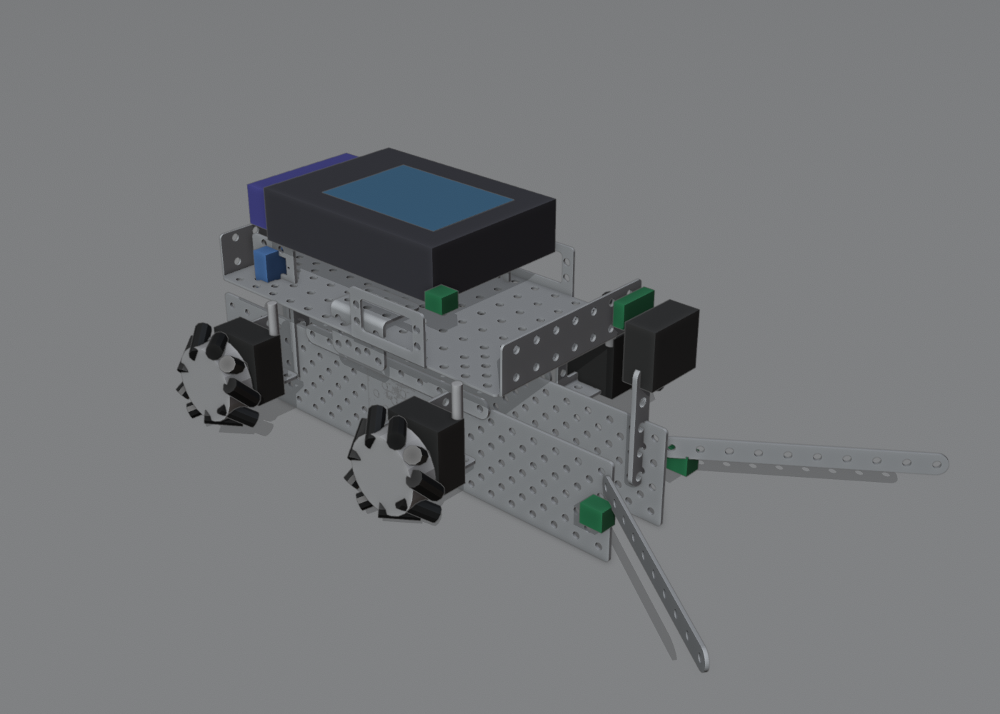
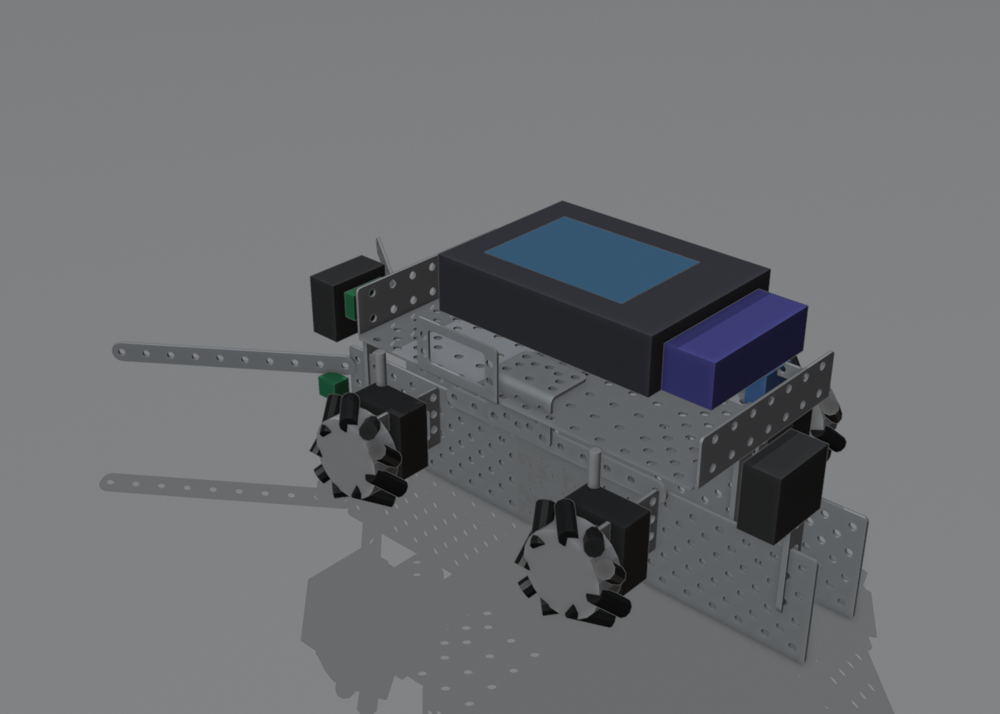
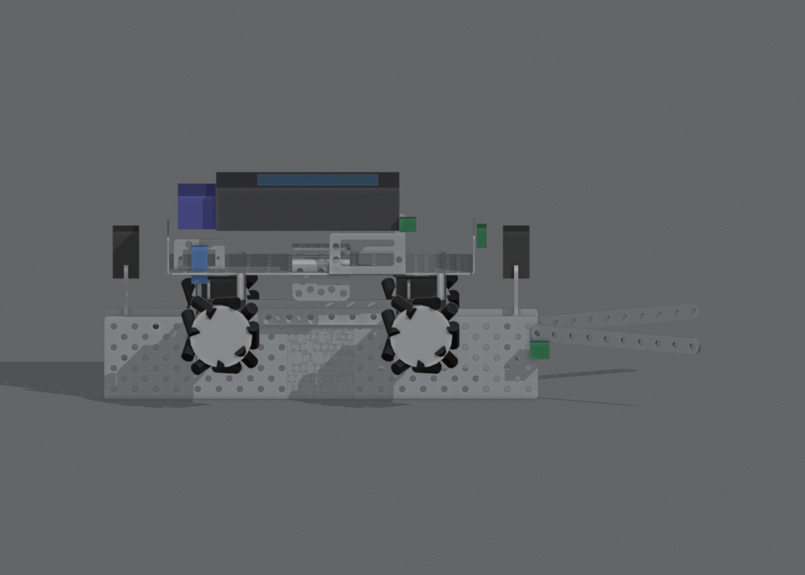
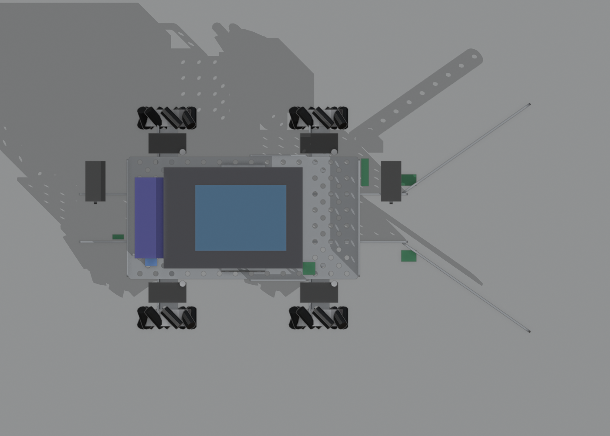
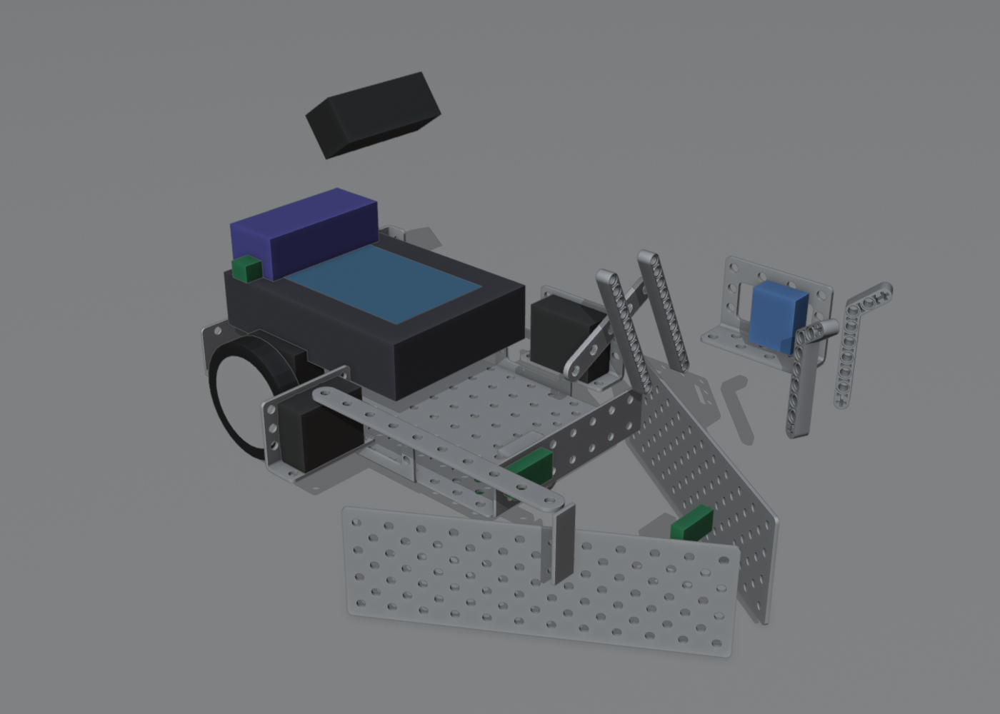
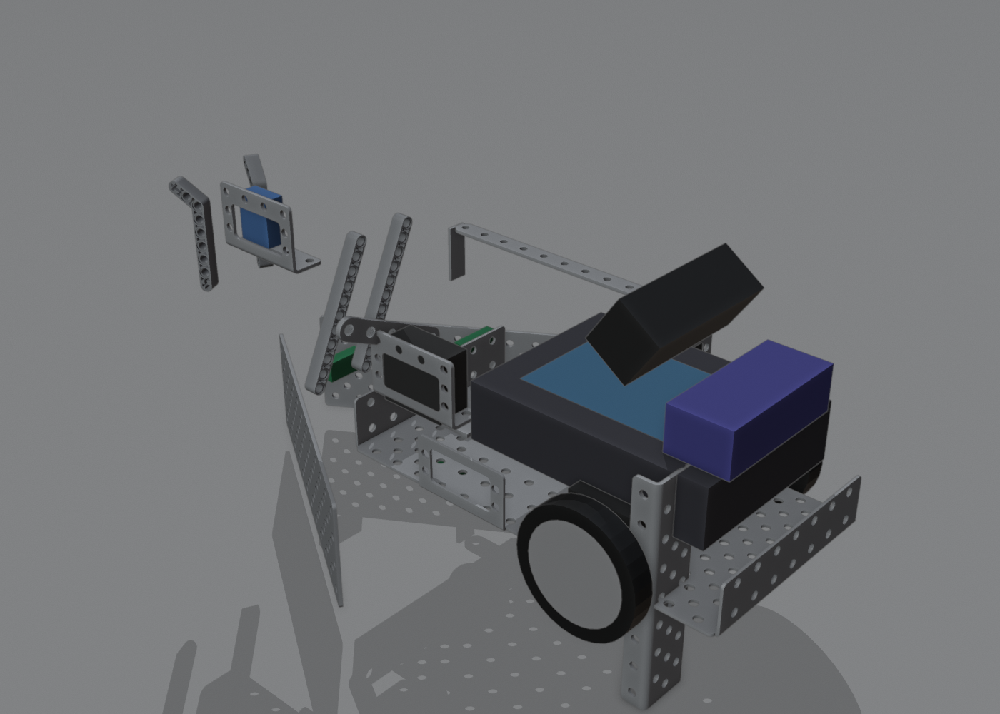
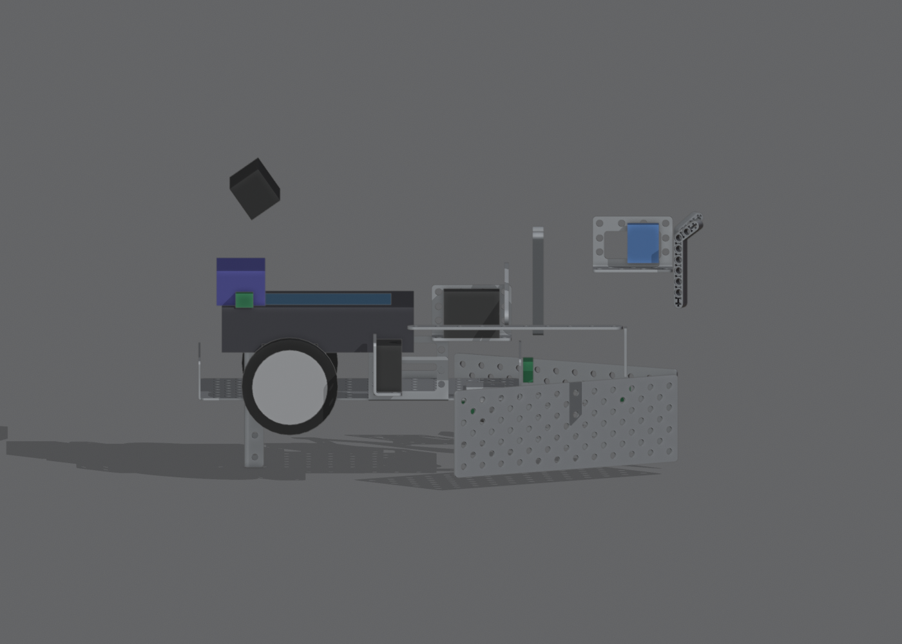
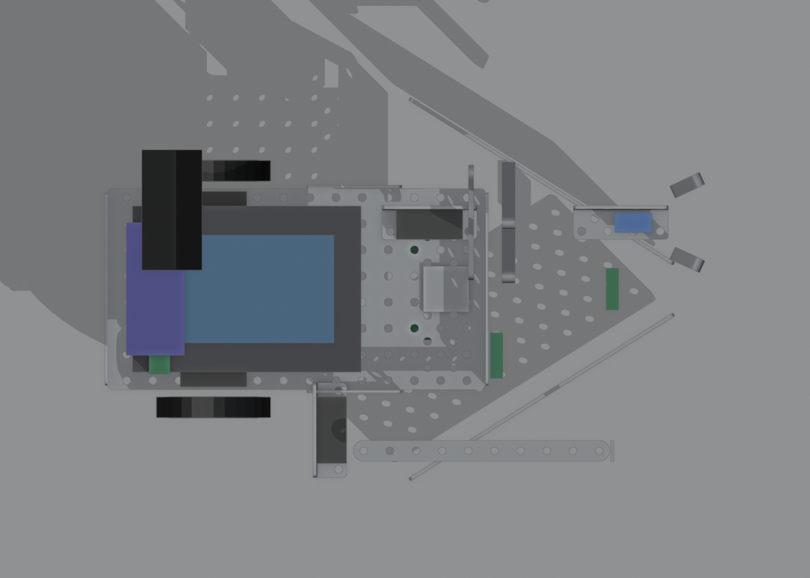

# The two robots: how they should look, every part and what it does

Plan: [STRATEGY.md](../STRATEGY.md). Model: [blender/](../blender/README.md) (every part is in `blender/out/fall_game_2026.blend`; step-by-step build in [guide/index.html](../guide/index.html)). Renders below are made by `tools/render_robots.py` from that model. Part sizes marked *estimate* come from photos, so measure the real part.

## Robot A — "Duck Runner" (17.9 × 9.1 × 6.5 in, mecanum, 1 Wombat)

Collects all 5 ducks on the centre lane and drops exactly one in each of the 5 zones (that is the ×5 multiplier).

| View | |
|---|---|
| Front-left |  |
| Rear-right |  |
| Side |  |
| Top |  |

**What it looks like:** a flat, wide 4-wheel mecanum car. The chassis floor is raised about 3" on standoffs, and a **12.5" long, 1.8" wide open-bottom lane** runs underneath it (the ducks ride through under the robot). Two flared straps at the front form a funnel that guides a duck into the lane. Wombat and battery sit on top. Nothing is taller than 6.5", so it passes under the 12" start ceiling with room to spare.

| Part (kit line) | Qty | What it does |
|---|---:|---|
| Chassis (Metal) | 1 | Main frame, raised on standoffs |
| Standoff 8-32 × 1" (Metal) | 4 | Lift the chassis floor so the duck lane fits underneath |
| Black gear motor (Electronics) | 4 | One per mecanum wheel; strafing sideways lines up each drop |
| Servo bracket (Metal) | 4 | Hold the four motors |
| Mecanum wheel (Electronics) | 4 | Omnidirectional drive: move sideways without turning |
| Plate 4 × 12 (Metal) | 4 | Lane walls, on edge, two per side |
| Strap 1 × 10 (Metal) | 4 | 2 splice the plates into one long wall, 2 flare out as the intake funnel |
| Angle bracket (Metal) | 2 | Join the lane walls to the chassis |
| Servo (Electronics) + 1 × 5 servo horn | 2 + 2 | **Intake gate** (front) and **exit gate** (rear): horns swing 90° to open |
| Micro servo + micro servo mount + 1 × 5 horn | 1 | **Pin gate**: holds back all but one duck so only one drops per zone |
| Tophat sensor (Electronics) | 2 | Look down at the tape edge to line-follow the centre lane and stop in the right place |
| ET rangefinder (Electronics) | 1 | Distance to the wall before each drop |
| Small touch switch (Electronics) | 1 | "Lane full" signal at the lane rear |
| Light sensor (Electronics) | 1 | Starts the robot on the starting light |
| Wombat controller (Electronics) | 1 | The brain: 4 motor ports (all used), servos, sensors |
| Wombat battery (Electronics) | 1 | Power |

Port budget: 4 of 4 motor ports (so the gates are servos, not motors). 2 servos + 1 micro servo of the 5 + 2 in the kit.

## Robot B — "Point Scorer" (14.4 × 9.2 × 8.7 in, 2-wheel + caster, 1 Wombat, camera)

Everything else: flips both cups, pushes the 5 pom stacks into zone 1, grabs the hidden red pom with the camera and sets it alone on the platform (250 points with the ×5), knocks a pickleball under the platform.

| View | |
|---|---|
| Front-left |  |
| Rear-right |  |
| Side |  |
| Top |  |

**What it looks like:** a small two-wheel demobot with a **V-shaped plow** across the front (two bent plates), a **side hook** on the right for flipping cups, and a **short arm with a two-finger claw** on top for the red pom. The camera sits on a mast that is folded down at the start so the robot stays under 12", and is raised after the start.

| Part (kit line) | Qty | What it does |
|---|---:|---|
| Chassis (Metal) | 1 | Main frame |
| Black gear motor (Electronics) | 2 | Left and right drive |
| Solarbotics wheel + hub (Electronics) | 2 | Drive wheels |
| Caster (Metal) | 1 | Rear support ball |
| Plate 4 × 12 (Metal), bent 90° | 2 | The V plow: pushes pom stacks as separate groups and shoves the pickleball |
| Strap 1 × 10 (Metal), bent 90° | 1 | Cup hook: catches the cup rim and flips it upright |
| Servo (Electronics) + servo bracket | 2 | One lifts the arm (shoulder), one swings the cup hook |
| Micro servo + bracket | 1 | Opens and closes the claw |
| LEGO liftarms 1 × 11 and claw fingers | 4 | The paralleling arm (keeps the claw level while it lifts) and the two claw fingers |
| Camera (Electronics) | 1 | Finds the red pom by colour |
| Channel 3 × 8 (Metal) | 1 | Camera mast |
| Tophat sensor (Electronics) | 2 | Line following and stopping on tape |
| ET rangefinder (Electronics) | 1 | Distance to walls and the platform |
| Lever switch (Electronics) | 1 | Bumper on the plow: "touched the wall/cup" |
| Light sensor (Electronics) | 1 | Starts the robot on the starting light |
| Wombat controller + battery (Electronics) | 1 + 1 | Brain and power (2 of 8 kit motor ports unused) |

## 3D-printed parts

Allowance (rules p.12): **6 small** (≤ 60 × 60 × 20 mm), **2 mid** (≤ 220 × 220 × 80 mm), **1 large** (≤ 220 × 220 × 250 mm); PLA/PETG, grey; STL submitted before the event. The **team's print plan** is [3D_PRINTS.md](../3D_PRINTS.md):

| Slot | Part | Robot | What it does |
|---|---|---|---|
| 2 mid | Duck lane, two 160 mm halves | A | Exact 1.8" channel, smooth walls, built-in funnel and the three gate-servo mounts (replaces the bent plates and straps) |
| 2 small | Claw pads | B | Cup-shaped pads that grip the 1.6" soft red pom |
| 1 small | Cup hook | B | Lipped hook that catches the cup rim at any approach angle |
| 2 small | Plow end caps | B | Round the plow tips so a pushed pom stack stays one group |
| 1 small | Flap pad | A | Wider intake gate face so ducks can't squeeze past |
| 1 large | Ring fork (stretch) | B | Slides under 3 rings on a post and lifts them onto a bottle neck (needs a lift the arm doesn't have yet) |

Ready-made STLs from the Blender generator (`python tools/blender/build_parts.py`, files in [parts/out](../parts/out), size check in [parts/out/budget.md](../parts/out/budget.md)): `duck_cage`, `claw_palm`, `claw_jaw`, `camera_mount`, `tophat_bracket` ×2, `light_shroud` ×2, `ring_fork`. They go with the alternative plan ([strategy-alt.md](strategy-alt.md), described in [parts.md](parts.md)); the same generator can produce the parts above.

## Is a chassis printed?

No: both robots use the **kit metal chassis** (2 in the 2026 kit). Reasons, and when that would change:

- A printed part must fit one Ender 3 V3 SE bed: **220 × 220 mm (8.7")** footprint at most. Robot A is 17.9" long, so a printed chassis can't be one piece, and splitting it into parts counts as one part (anti-circumvention rule).
- Only the **1 large + 2 mid** slots can hold a part that size, and they are already used (duck lane, ring fork).
- The kit chassis is free, stiff and has the standard hole pattern.
- **Risk to check:** the rules ban "the old KIPR aluminum chassis" and don't say which one the 2026 kit chassis is. If the Head Judge says it's not allowed, a printed base plate (≤ 8.7" square, mounting the Wombat on its 112.7 × 83.8 mm hole pattern) becomes the fallback for Robot B.
