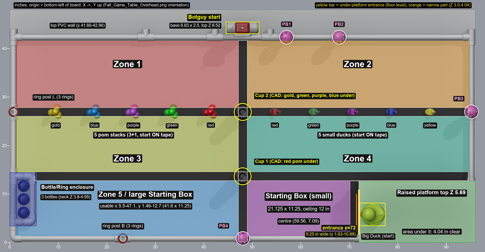

# 2026 Botball Fall Game: field map

Authoritative geometry of the game table, in inches, built from the official CAD model and checked against the rules and the table build drawings.

Machine-readable: `data/field_map.json`. Code: `tools/field_geom.py` (`python tools/field_geom.py --selftest` passes 71 checks). Pictures: `docs/renders/top_annotated.png` (zones overlay), `top_ortho.png`, `iso.png`, `platform_front.png`.



Tags used below: **[rules]** stated in `docs/official/Botball_Fall_Game_Rule_Summary.txt`; **[pdf]** stated in `Fall_Game_Table.pdf` (9 sheets); **[cad]** measured from `Fall_Game_Table.glb`; **[derived]** computed from those; **[inferred]** our reading, not stated anywhere.

## 1. Conventions and method

- Origin is the bottom-left corner of the board as drawn in `docs/official/Fall_Game_Table_Overhead.png`. **X** runs along the 96 in length (left to right), **Y** across the 48 in width (bottom to top), **Z** is height above the FRP surface. [derived]
- Blender (GLB) to field: `X = (1.2192 - y_m)/0.0254`, `Y = (x_m + 1.2192)/0.0254`, `Z = (z_m - 0.0213)/0.0254`.
- **Use the tight boxes, not `data/glb_objects_raw.json`.** The raw dump took `Object.bound_box` corners through the world matrix. For meshes imported with a non-90-degree rotation that box is inflated. 30 of the 146 meshes differ by more than 0.02 in, up to 0.7 in: a cup reads 5.0 in wide (really 3.63), a ring 2.71 (really 2.13), a pickleball 3.25 to 3.53 (really 2.91), and several pipes look 1.8 in thick (really 1.30). `tools/extract_glb_profiles.py` re-extracts vertex-tight boxes into `data/glb_objects_tight.json`; every number here uses those. [cad]
- Board: 96 x 48 in. FRP is 0.077 in thick over 0.75 in particle board (the BOM says "3/8 in or similar"; see section 9). FRP is laid "bumpy side up" so the surface is textured. [cad, pdf sheet 3]
- Playing interior (PVC inner edges): X 1.462 to 94.538, Y 1.462 to 41.662, which is the 93.08 x 40.20 given on PDF sheet 8. [pdf, checked]
- Piece spacing: ducks and pom stacks are both 8.00 in apart (PDF sheet 9). [pdf, checked]

## 2. Black tape (four strips)

Tape is 1.875 in wide in the CAD (3M #3920 is 1-7/8 in), not 2 in, and 0.01 in thick. [cad]

| Strip | X range | Y range | Length |
|---|---|---|---|
| Center vertical | 47.125 to 49.000 | 0.162 to 41.663 | 41.5 |
| Lower horizontal | 5.038 to 94.537 | 12.713 to 14.588 | 89.5 |
| Upper horizontal ("center lane") | 1.037 to 94.538 | 25.963 to 27.838 | 93.5 |
| Short vertical | 70.125 to 72.000 | 0.713 to 12.713 | 12.0 |

- The center strip is centred on the PVC T-couplers (X 48.06). The short strip is flush with the platform's corrugated edge at X 72.0. [pdf sheet 7]
- The upper horizontal strip carries every duck and pom stack, and its crossing with the center strip carries Cup 2. The lower strip crossing carries Cup 1. All of them start touching tape. [cad]

## 3. Zones, boxes, enclosure

Zones are bounded by the inner tape edges and the PVC inner edges. [rules p.7, derived]

| Zone | X range | Y range | Size | Area (sq in) |
|---|---|---|---|---|
| Zone 1 top-left | 1.462 to 47.125 | 27.838 to 41.662 | 45.66 x 13.82 | 631 |
| Zone 2 top-right | 49.000 to 94.538 | 27.838 to 41.662 | 45.54 x 13.82 | 630 |
| Zone 3 middle-left (pom side) | 1.462 to 47.125 | 14.588 to 25.963 | 45.66 x 11.38 | 519 |
| Zone 4 middle-right (duck side) | 49.000 to 94.538 | 14.588 to 25.963 | 45.54 x 11.38 | 518 |
| Zone 5 lower-left, large Starting Box | 1.462 to 47.125 | 1.462 to 12.713 | L-shape, see below | 476 |
| **Small Starting Box** | 49.000 to 70.125 | 1.462 to 12.713 | **21.125 x 11.25**, ceiling 12 in | 238 |

- The small box matches the rules (11.25 x 21.125 x 12 in, p.3) exactly. It is bounded by the center strip, the short strip, the lower strip and the bottom PVC. Centre (59.56, 7.09). [rules, derived]
- Zone 5 is the rectangle minus the enclosure at its left end: polygon (1.462,1.462), (47.125,1.462), (47.125,12.713), (5.5,12.713), (5.5,3.375), (1.462,3.375). Usable robot start area is X 5.5 to 47.125, Y 1.462 to 12.713 (41.6 x 11.25), centre (26.3, 7.09). [derived]
- The rules do not give the large box a size or say whether a robot may start anywhere in Zone 5. Section 10 lists this.
- Zone 5 is on the multiplier list; the small box is not. The rules wording differs between pages (section 9).

**Bottle/Ring enclosure** [cad, derived]. Outer footprint X 0 to 5.5, Y 3.375 to 14.375. It is a closed U of floor-level PVC (wall tops at Z 1.46): left wall is the board-edge pipe, right wall is the 8 in pipe at X 4.04 to 5.34, bottom and top are 2.5 in pipes at Y 3.54 to 4.84 and 12.91 to 14.21. The pocket inside is X 1.462 to 4.038, Y 4.837 to 12.913 (2.58 x 8.08 in). Three bottles stand in a row along Y. There is no gate; pieces go over the 1.46 in walls. The bottle bodies overlap the right wall pipe by about 0.12 in in the CAD.

**Beyond the top wall.** The board continues 5.1 in past the top PVC wall (Y 42.96 to 48). Botguy stands there, and "Botguy's starting position" for the Big Duck is in this strip. [cad]

## 4. PVC walls and fittings

All PVC is 1 in SCH 40 pipe (BOM says "1 in ID"; CAD pipe is 1.30 in OD) with 1 in elbows and tees. The BOM counts match the CAD: 31 pipes, 9 elbows, 17 tees. Full list with boxes is in `field_map.json` under `pvc`. [pdf sheet 2, cad]

| Wall | Pipe top Z | Notes |
|---|---|---|
| Bottom (Y 0.162 to 1.462) | 1.46 | pipes of 21.125, 23.375, 23.375, 17.625 in; tees T_2 (post B, X 21.6 to 25.0) and T_1 (pickleball 4, X 46.4 to 49.75) rise to Z 2.5 |
| Top (Y 41.66 to 42.96) | 1.46 | 25.875, 12.875, 10, 9.5, 25.875 in |
| Left (X 0.162 to 1.462) | 1.46 | 8 in, 12 in, 14 in; tee T_43 (post L, Y 25.25 to 28.63) rises to Z 2.5 |
| Right (X 94.538 to 95.838) | 1.46 | 9.5, 13.875, 14 in; tee T_44 (pickleball 3) rises to Z 2.5 |

- In-plane tees and elbows top out at Z 1.623. Tees and elbows with a vertical socket reach Z 2.498 (T_1, T_2, T_3, T_4, T_6, T_12, T_13, T_43, T_44, elbow_7). [cad]
- Three tees on the top wall point outward past the wall to Y 44.0 (T_39 at X 26.4 to 29.75, T_14 at X 40.6 to 44.0, T_10 at X 52.0 to 55.4), plus the two top corner tees. Botguy's wheelbase (X 44.59 to 51.41) fits between T_14 and T_10, which leave an 8.0 in gap (X 44.0 to 52.0). What these stubs are for is not stated; the rules put starting lights "on the outside edge of the game table", so they are probably light mounts. [cad, inferred]
- Four short "1.75 in" pipes are spacers inside corner fittings (PDF sheet 4 "1.75 in PVC inside"). They matter to nothing.

## 5. Raised Platform and the area under it

Platform plate [cad]: X 72.0 to 96.0, Y 0 to 12.5 (24 x 12.5), underside Z 5.498, **top Z 5.686** (0.19 in plate). Flush with the right and bottom board edges.

Supports: four 2.5 in legs (Z 1.5 to 4.0) at the four corners of a 19 x 10.9 in rectangle, each topped by an elbow that carries a 9.5 in beam running along Y at Z 4.036 to 5.336. The left beam is at X 72.16 to 73.46, the right at X 91.16 to 92.46. The legs stand in tees or an elbow on floor-level 17.625 in pipes (bottom edge at Y 0.162 to 1.462, inner at Y 11.04 to 12.34).

Skirt [cad, pdf sheet 6]: a 24 x 5.5 in corrugated strip at Y 12.5 to 12.687, Z 0 to 5.498, closing the +Y side (the side facing the table interior). Its 1.625 x 1.625 in notch is at the **right** end (X 94.375 to 96, Z 0 to 1.623) in the CAD, where tee T_7 passes through the skirt plane. PDF sheet 6 draws the notch at the left end of the flat pattern; it is the same cut seen mirrored. The notch is at the far right wall and is not usable as a gap.

**Under the platform** (the "Area Under the Raised Platform", rules p.7) [cad, derived]:

| Item | Value |
|---|---|
| Footprint | X 72.0 to 96.0, Y 0 to 12.5 |
| Open side | Only the **left (-X) side, at X = 72.0**, facing the small Starting Box. Gap between the box edge (X 70.125) and the opening: 1.875 in, which is the short tape. |
| Closed sides | +Y: skirt, full height. -Y and +X: board edge with a floor-level pipe; nothing above Z 1.46, but beyond the edge is the table edge, so a piece pushed there leaves the board. |
| Clear height at the entrance | **4.036 in** (underside of the left beam). Below the corner elbows (Z under 2.998) the clear width is **9.25 in** (Y 1.625 to 10.875, between tee T_3 and elbow_7). Between Z 2.998 and 4.036 the elbows narrow it to **7.5 in** (Y 2.5 to 10.0). Above 4.036 the beam closes it. |
| Pipe-to-pipe gap at floor level | Y 1.462 to 11.038 (9.58 in), but the floor fittings cut it to 9.25 |
| Free board surface inside | X 72.0 to 94.538, Y 1.625 to 10.875 (22.5 x 9.25 in) |
| Floor obstructions | 17.625 in pipe along Y 0.162 to 1.462 (X 73.5 to 91.1); 17.625 in pipe along Y 11.04 to 12.34 (X 73.5 to 91.1), directly inside the skirt; right-wall pipe X 94.54 to 95.84; fittings T_3, T_4, T_6, T_7, elbow_1, elbow_7. Pipes are 1.46 in tall. |
| Tape inside | None. The short tape ends at X 72.0, so under-platform pieces cannot be disqualified by tape unless they rest on it outside the opening. |

Fit checks: a pickleball (2.91 in) and a small duck (2.27 x 1.46 x 1.46 in) both pass the 4.04 in height and the 7.5 in narrow width. A robot body or pusher that goes in needs to be under 4.0 in tall and 7.5 in wide at the beam (9.25 in wide below Z 3.0). [derived]

The Big Duck sits on the platform with its beak 0.13 in from the left edge, so the nearest edge of the platform to a robot is where the duck stands. `docs/renders/platform_front.png` shows the entrance as a robot leaving the box sees it.

## 6. Game pieces as modelled [cad]

Positions are centres (X, Y); Z is the top of the piece.

| Piece | Count | Position | Size / notes |
|---|---|---|---|
| **Botguy** | 1 | base centre (48.0, 44.25); outside the top wall | X 44.59 to 51.41, Y 42.46 to 45.50 (base 6.83 x 2.5), Z top **8.52**. Grey base to Z 2.5, red torso to 4.5, red head to 8.0, grey revolve part (antenna) to 8.52. Faces -Y; visor at Y 42.46 to 42.96, Z 5.4 to 6.1. |
| **Big Duck** | 1 | (74.80, 5.75) on the platform | X 72.13 to 77.46, Y 3.37 to 8.14, Z 5.63 to **10.08** (5.33 x 4.77 x 4.45). Faces -X. Two mirrored halves (Mirror3 y 5.75 to 8.14, Split Line2 y 3.37 to 5.75). |
| Small ducks | 5 | Y 26.90, X = 54.68 red, 62.68 green, 70.68 lavender, 78.68 blue, 86.68 yellow | 2.27 x 1.46 x 1.46 including beak; face +X; start on the upper tape |
| Pom stacks (visible) | 5 x 4 | Y 26.90, X = 9.46 gold, 17.46 turquoise, 25.46 lavender, 33.46 green, 41.46 red | pom Ø 1.5; 3 on the board in a triangle (about 0.8 in off the stack centre) plus 1 on top (Z 1.22 to 2.72); start on the upper tape |
| Hidden poms | 5 | under cups, see below | 1 per colour |
| Cups | 2 | Cup 1 (48.02, 13.62), Cup 2 (48.05, 26.91) | upside-down: mouth Ø **3.63** on the board, base Ø about 2.5, height **5.70** (not 5.0 wide: raw bbox was inflated). Cup 1 sits on the lower/center tape crossing, Cup 2 on the upper/center crossing. |
| Blue bottles | 3 | X 2.90; Y 6.13, 8.88, 11.63 | height 4.95; body Ø 2.53 to Z about 2.7; shoulder to Z 3.8; **neck Ø about 1.06 (inside about 1.0), Z 3.8 to 4.95**, with a Ø 1.30 flange at Z about 4.1 (estimates from mesh slices) |
| Rings | 6 | post L ring stack at (0.82, 26.93) and post B at (23.32, 0.81); Z 2.46 to 3.54 (3 stacked, 0.36 in each) | **OD 2.13, ID 1.41**, thickness 0.36. Rings reach 0.25 in past the board edge and 0.42 in past the pipe inner edge into the field. |
| Ring posts | 2 | L (0.81, 26.94); B (23.31, 0.81) | 8 in pipe, Ø 1.30, seated in tees T_43 and T_2; **top Z 9.50**; 7.0 in exposed above the tee |
| Pickleballs | 4 | PB1 (57.06, 42.31) on T_12; PB2 (67.94, 42.31) on T_13; PB3 (95.19, 26.94) on T_44; PB4 (48.06, 0.81) on T_1 | Ø 2.91; Z 2.29 to 5.22 (centre 3.75); PB3 and PB4 overhang the board edge by about 0.64 in |

Hidden poms **as modelled**: Cup 1 (nearest the Starting Box) hides **1** pom, the red one (centre (47.8, 13.4)). Cup 2 hides **4**: gold (48.4, 27.8), green (48.6, 26.3), lavender (47.2, 26.8), with turquoise (48.1, 26.9) stacked on top. The rules say 3 under one cup and 2 under the other; see section 9.

Ring and neck fit, which matters for ring scoring [derived from mesh]: ring ID 1.414 vs post OD 1.30 and neck flange Ø 1.30 leaves only about 0.06 in per side. A ring comes to rest on the bottle shoulder at Z about 3.67 and three rings stack to about 4.75, below the neck top at 4.95, so all three can break the neck volume on one bottle.

## 7. Key distances

Straight-line XY distances in inches, from `python tools/field_geom.py --md-distances`. "Nearest edge" is the gap between the small box rectangle and the item's bounding rectangle, so 0.0 means they overlap.

| Item | X | Y | Top Z | From small-box centre | From small-box nearest edge | From Zone 5 centre |
|---|---|---|---|---|---|---|
| cup1 | 48.02 | 13.62 | 5.70 | 13.3 | 0.0 | 22.7 |
| cup2 | 48.05 | 26.91 | 5.70 | 22.9 | 12.4 | 29.4 |
| duck_red | 54.68 | 26.90 | 1.46 | 20.4 | 13.5 | 34.6 |
| duck_green | 62.68 | 26.90 | 1.46 | 20.1 | 13.5 | 41.4 |
| duck_lavender | 70.68 | 26.90 | 1.46 | 22.7 | 13.5 | 48.6 |
| duck_blue | 78.68 | 26.90 | 1.46 | 27.5 | 15.4 | 56.0 |
| duck_yellow | 86.68 | 26.90 | 1.46 | 33.6 | 20.5 | 63.5 |
| platform_opening (x=72) | 72.00 | 6.25 | 4.04 | 12.5 | 1.9 | 45.7 |
| under_platform (free floor centre) | 83.27 | 6.25 | - | 23.7 | 1.9 | 57.0 |
| pickleball1 | 57.06 | 42.31 | 5.21 | 35.3 | 28.1 | 46.8 |
| pickleball2 | 67.94 | 42.31 | 5.19 | 36.2 | 28.1 | 54.5 |
| pickleball3 | 95.19 | 26.94 | 5.22 | 40.8 | 26.8 | 71.7 |
| pickleball4 | 48.06 | 0.81 | 5.19 | 13.1 | 0.0 | 22.6 |
| post_left (ring post L) | 0.81 | 26.94 | 9.50 | 62.0 | 49.4 | 32.3 |
| post_bottom (ring post B) | 23.31 | 0.81 | 9.50 | 36.8 | 25.0 | 7.0 |
| bottle1 | 2.90 | 6.13 | 4.95 | 56.7 | 44.8 | 23.4 |
| bottle2 | 2.90 | 8.88 | 4.95 | 56.7 | 44.8 | 23.5 |
| bottle3 | 2.90 | 11.63 | 4.95 | 56.8 | 44.8 | 23.9 |
| botguy | 48.00 | 44.25 | 8.52 | 38.9 | 30.3 | 43.0 |
| big_duck | 74.80 | 5.75 | 10.08 | 15.3 | 2.0 | 48.5 |
| pom_stack_gold | 9.46 | 26.90 | 2.72 | 53.9 | 40.3 | 26.0 |
| pom_stack_turquoise | 17.46 | 26.90 | 2.72 | 46.5 | 32.8 | 21.7 |
| pom_stack_lavender | 25.46 | 26.90 | 2.72 | 39.4 | 25.6 | 19.8 |
| pom_stack_green | 33.46 | 26.90 | 2.72 | 32.8 | 19.1 | 21.1 |
| pom_stack_red | 41.46 | 26.90 | 2.72 | 26.8 | 14.2 | 24.9 |

Other useful lengths:
- Start box top edge (Y 12.713) to the duck/pom lane (Y 25.963, lower edge): 13.25 in. Lane tape is 1.875 in wide, so a duck or pom stack on it must be moved at least that far to leave the tape.
- Big Duck to Botguy's start: 46.9 in between centres (dx 26.8, dy 38.5), and the last 2 in are over the top PVC wall.
- Ring post B to the enclosure's right edge (X 5.5): 17.8 in along the bottom wall. Ring post L to the enclosure's top edge (Y 14.375): 12.6 in along the left wall, 15.3 in to the nearest bottle centre.
- Cup 1 and PB4 touch the Starting Box rectangle: the cup mouth (radius 1.81) covers the box's upper-left corner (the corner is 1.34 in from the cup centre), and PB4's bounding box overlaps the box's lower-left corner by 0.51 x 0.81 in at Z 2.3 to 5.2.
- Circle-accurate start-box intrusions (added by the completeness review, [derived] from the tight CAD positions; rules say nothing about them, but both pieces are on the table when a robot starts): Cup 1 occupies a notch of about **0.6 x 0.6 in** in the box's upper-left corner (the cup edge meets the box top edge at X 49.59 and the box left edge at Y 12.09), at floor level where the mouth is widest. PB4 (ball centre Z 3.75, Z 2.3 to 5.2) intrudes about **0.36 x 0.46 in** into the lower-left corner (meets the bottom edge at X 49.36 and the left edge at Y 1.92). A robot starting flush in that corner needs a chamfer or relief there, or must start the 0.6 in away.

**Duck travel to each zone** (`python tools/duck_routes.py`, [derived]). Straight-line distance in inches from a duck's start to the nearest spot where it rests fully inside a zone, clear of tape and PVC (zone rectangle shrunk by 1.2 in; Zone 5 uses the usable start rectangle X 5.5 to 47.125). It ignores obstacles and the robot's pushing geometry.

| duck | Z1 | Z2 | Z3 | Z4 | Z5 |
|---|---:|---:|---:|---:|---:|
| red (X 54.68) | 9.0 | 2.1 | 9.0 | 2.1 | 17.7 |
| green (X 62.68) | 16.9 | 2.1 | 16.9 | 2.1 | 22.7 |
| lavender (X 70.68) | 24.8 | 2.1 | 24.8 | 2.1 | 29.1 |
| blue (X 78.68) | 32.8 | 2.1 | 32.8 | 2.1 | 36.2 |
| yellow (X 86.68) | 40.8 | 2.1 | 40.8 | 2.1 | 43.6 |

All five ducks start on the right half (X > 49). Zones 2 and 4 are one 2.1 in nudge away; Zones 1, 3 and 5 all need a carry across the center tape strip. The cheapest assignment of five ducks to five different zones is about 59 in of straight-line carrying in total (yellow and blue to Z2/Z4, red to Z3 at 9.0, green to Z1 at 16.9, lavender to Z5 at 29.1), and the Z1/Z3 carries pass Cup 2, which stands on the center-strip crossing at (48.05, 26.91). Zone 5 is the farthest and is also the zone with the ambiguous multiplier status (section 10, item 1). A fourth-zone-only plan (Z1 to Z4) needs about 30 in of carrying.

## 8. Heights robots must clear, and travel notes

| Feature | Top Z (in) | Where |
|---|---|---|
| Black tape | 0.008 | flat, nothing to climb |
| PVC border and enclosure pipes | **1.46** | all four borders, enclosure U, floor pipes under the platform |
| In-plane fittings | 1.62 | corners and mid-wall tees |
| Fittings with a vertical socket | 2.50 | T_1, T_2, T_12, T_13, T_43, T_44 on the borders |
| Small ducks | 1.46 | upper lane |
| Pom stacks | 2.72 | upper lane left half |
| Ring stack | 3.54 | on both posts, Z 2.46 to 3.54 |
| Platform entrance (clear under beam) | **4.04** (3.0 under the elbows) | X = 72, Y 1.6 to 10.9 |
| Bottles | 4.95 | enclosure |
| Pickleballs | 5.2 (bottoms at 2.3) | top, right, bottom walls |
| Cups (upside-down) | 5.70 | center crossings |
| Platform underside / top | 5.50 / **5.69** | X 72 to 96, Y 0 to 12.5 |
| Botguy | **8.52** | top strip |
| Ring posts | **9.50** | left wall, bottom wall |
| Big Duck on platform | 10.08 (4.4 above the plate) | platform |
| Starting ceiling | **12.0** | applies at start only; after the start "robots are allowed to expand" [rules p.12] |

Travel notes (from `field_geom.py --path`, straight lines from the Starting Box):
- The open field has no 3D obstacle between the Starting Box and any interior item. Straight paths cross only tape (0.008 in). The only solids inside the playing interior are the cups, the two ring posts and PB1-PB4 stubs (all on the borders), the enclosure U, and the platform assembly.
- Platform entrance: from the box's right edge it is 1.875 in of tape, then the opening. Entrance Y span (1.6 to 10.9) lies inside the box's Y span (1.46 to 12.71), so a robot can drive straight in along +X.
- PB4 (bottom wall, X 48.06) is within about 1 in of the box's bottom-left corner, under the center tape line. Cup 1 is right at the box's upper-left corner.
- Duck lane: ducks at X 54.7 and 62.7 are directly above the box (box X is 49 to 70.1); lavender at 70.7 is 0.6 in past the right edge; blue and yellow are 8 and 16 in further right, above the platform's lane.
- Ring post B and PB4 are on the bottom wall, left of the box, reachable along Zone 5. Ring post L and the pom stacks are on the far left half; bottles at the far left bottom.
- Botguy is outside the top wall: the straight line from the box crosses the lower strip, the upper strip, the center strip and the 10 in top pipe, and ends over the strip behind it. Anything that scores 15 for the Big Duck must go over the top wall (Z 1.46) at X 44 to 52.
- Pieces that start on tape (ducks, pom stacks, cups) are worth nothing there. Cups can still score the nesting and upright bonuses on tape; a cup on tape earns no base point [rules p.5].

## 9. CAD vs rules

Rules win wherever the two disagree. Items 1 to 4 change how a team should set up its practice table.

| # | Topic | Rules | CAD | Effect |
|---|---|---|---|---|
| 1 | Cup colour | green and teal (p.4) | both black ("Cup - Black-1/2") | Use one green and one teal cup. Which colour is nearest the box is not stated. |
| 2 | Hidden poms per cup | 2 under one, 3 under the other; the red pom plus two others under the cup nearest the Starting Box (p.4) | 1 under Cup 1 (red only), 4 under Cup 2 (gold, green, lavender, turquoise stacked 3+1) | Set up 3 under the near cup (red + 2 others), 2 under the far cup. Which two colours go with red is not stated. |
| 3 | Pickleball mounting | "mounted on posts" (p.4) | on tee sockets (stubs 2.5 in tall) at the border, 3 on the top/right/bottom walls overhanging the board, 1 at the bottom centre | "Posts" means these tees; the ball sits about 0.2 in into the socket. Not the 8 in ring posts. |
| 4 | Ring post "near the blue bottles" | far-left post and the post near the blue bottles (p.4) | post L (0.81, 26.94), post B (23.31, 0.81) | Post B is 17.8 in from the enclosure's right edge. Wording is loose; the CAD is the only location source. |
| 5 | Ring size | not given | OD 2.13, ID 1.41, thickness 0.36 (mesh names say "1.75in", cause unknown) | Build rings to the mesh; ID 1.41 is only 0.06 in per side over a 1.30 in pipe. |
| 6 | Cup size | not given | mouth Ø 3.63, base Ø about 2.5, height 5.70, tapered | Raw bbox said 5.0 in wide; that is inflated. |
| 7 | Bottle neck | "neck breaks the interior volume of the ring" (p.5) | neck Ø about 1.06, 1.15 in tall, flange Ø 1.30 | Estimates from mesh slices; no official neck dimension. |
| 8 | Big Duck | "distinct from and larger than" small ducks (p.4) | 5.33 x 4.77 x 4.45 vs small 2.27 x 1.46 x 1.46 | consistent |
| 9 | Botguy start | "centered left-to-right at the far top edge" (p.4) | centred X 48.0, standing on the strip beyond the top PVC wall | consistent; the rules never say the strip is behind a wall |
| 10 | Tape width | not given | 1.875 in (3M 3920 is 1-7/8 in). Earlier notes said 2 in | Use 1.875 in. |
| 11 | Board stock | BOM: particle board "3/8 in thick or similar" | CAD 0.75 in | No effect on the play surface; every Z here is measured from the FRP top. |
| 12 | Skirt notch position | PDF sheet 6: notch at the left of the flat pattern | notch at the right end (X 94.375 to 96) | Same cut, mirrored; no effect. |
| 13 | Pipe size | BOM "1 in ID SCH 40" | pipe OD 1.30 | BOM wording means nominal 1 in. |
| 14 | Small Starting Box | 11.25 x 21.125 x 12 in (p.3) | 21.125 x 11.251 | match |
| 15 | Multiplier exclusion | p.3: "the Starting Box" is excluded; p.6: "the smaller Starting Box" is excluded, and 5 numbered zones count | Zone 5 doubles as the larger box | See section 10. |
| 16 | Poms | 5 colours x 4 visible in stacks of 3+1 along the lane (p.4) | gold, turquoise, lavender, green, red; 3 on board + 1 on top, 8 in apart on the upper tape | consistent. Colours are not named in the rules except red. |
| 17 | Ducks | 5 colours in the center lane (p.4) | red, green, lavender, blue, yellow, on the upper tape, 8 in apart | consistent. Duck and pom colour orders differ: ducks left to right red, green, lavender, blue, yellow; poms gold, turquoise, lavender, green, red. |
| 18 | Zone 5 boundary at the enclosure | "distinct area bordering, but not part of, zone 5" (p.3) | no tape between them; PVC U only | We cut the enclosure's outer PVC footprint (X 0 to 5.5, Y 3.375 to 14.375) out of Zone 5. |

## 10. Open questions for the head judge or FAQ

1. Does the large Starting Box (Zone 5) count as a numbered zone for the Overall Multiplier? p.3 excludes "the Starting Box" without saying smaller; p.6 says "smaller Starting Box" and "each of the 5 numbered zones". Reading p.6, Zone 5 counts. `tools/score.py` carries a switch for this.
2. Where may a robot start inside Zone 5? Is the 12 in ceiling applied there? What is the large box's exact footprint (we use X 5.5 to 47.125)?
3. What counts as "Botguy's starting position" for the Big Duck: Botguy's base footprint (X 44.59 to 51.41, Y 43.0 to 45.5), or the pocket between the two tee stubs (X 44.0 to 52.0), or a looser area? It sits on board beyond the top PVC wall.
4. Which cup is green and which is teal? Which two poms go under the near cup with the red one?
5. Is a piece that rests on the floor pipes under the platform "touching the board surface"? Pipes occupy Y 0.162 to 1.462 and 11.04 to 12.34 there.
6. The tee stubs on the top wall (X 28.1, 42.3, 53.7): are they the light mounts, and may a robot or piece touch them?
7. Are robots and pieces allowed past the PVC border? The rules define no out-of-bounds line. Botguy (Y 43.0 to 45.5) and the Big Duck's 15-point spot are on board stock beyond the 1.46 in top wall, and pickleballs PB3 and PB4 hang over the board edge. Can a robot drive over a 1.46 in pipe, reach over it, or stand on the 5.1 in strip behind it?

## 11. Reproduce

```
"C:/Program Files/Blender Foundation/Blender 5.2/blender.exe" -b --factory-startup --python tools/extract_glb_profiles.py -- Fall_Game_Table.glb data/glb_profiles.json
python tools/build_field_map.py
python tools/field_geom.py --selftest
"C:/Program Files/Blender Foundation/Blender 5.2/blender.exe" -b --factory-startup --python tools/render_views.py -- <abs path to glb> <abs path to docs/renders>
python tools/annotate_top.py
```

Blender wants absolute paths for the GLB and the render folder; with relative paths `render_views.py` reports success but writes nothing.

## 12. Pictures

| File | What |
|---|---|
| `docs/renders/top_ortho.png` | orthographic top view, Workbench, 25 px per inch (X -2 to 98, Y -2 to 50) |
| `docs/renders/top_annotated.png` | same, with zones, boxes, platform, entrance and pieces overlaid |
| `docs/renders/iso.png` | 3/4 view from the bottom-left looking up the table |
| `docs/renders/platform_front.png` | the platform entrance as seen from inside the Starting Box |
